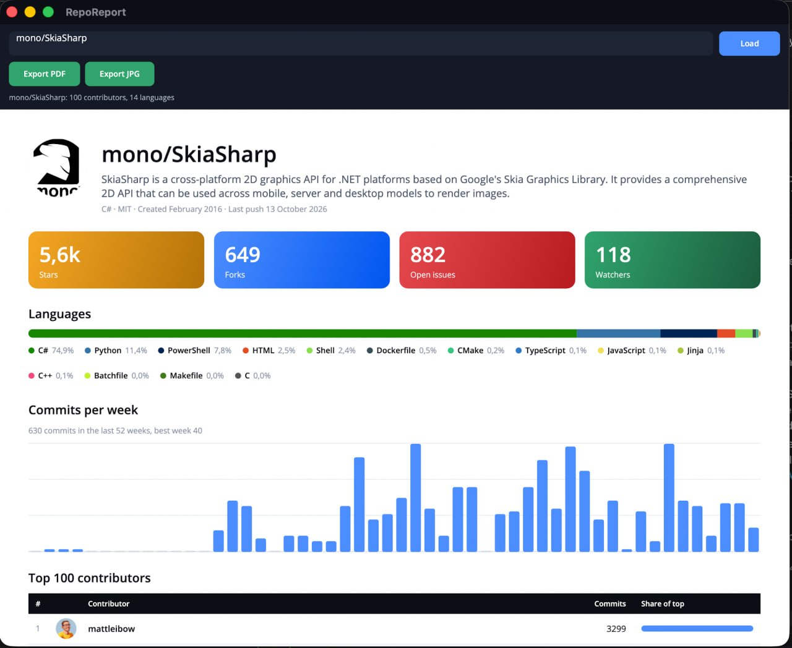

# RepoReport

A .NET MAUI sample for the article [Design PDF in MAUI XAML with DrawnUI](https://taublast.github.io/posts/DrawnPdf/):  
a report designed as a [DrawnUI](https://drawnui.net/) layout in XAML, bound to a view model, printed to a multi-page A4 PDF with SkiaSharp.  

In short: we generate a PDF report inside a MAUI app, fetching its data live from a remote API (GitHub) and filling a report UI defined in XAML via bindings.



The app asks the GitHub API for a repository (stars, forks, issues, languages, weekly commits, the top 100 contributors with avatars) and renders `Reports/ReportView.xaml` into:

- a multi-page A4 PDF, pages break between table rows, text stays selectable
- one tall JPEG

After an export the same report instance is shown on screen, cached as one image and scaled to fit the screen width.

## Run

```
dotnet build -f net10.0-windows10.0.19041.0   # Windows
dotnet build -f net10.0-maccatalyst            # Mac
dotnet build -f net10.0-ios                    # iOS
dotnet build -f net10.0-android                # Android
```

Run from the IDE or `dotnet run`. Type `owner/repo` and tap **Export PDF** or **Export JPG**; the data is fetched when needed (**Load** fetches it without exporting). A spinner shows while loading and rendering. Then:

- Windows: the file opens in the default viewer. **Preview window** opens the report at A4 width in a second window; edit `ReportView.xaml`, save, XAML hot reload shows the change.
- Mac Catalyst: a save panel. `Launcher.OpenAsync` does nothing there and `Share` crashes on completion (dotnet/macios binding), and the preview window is off: the scene manifest it needs leaves the main window empty on MAUI 10.0.80.
- Android and iOS: the share sheet.

Verified on Windows, Mac Catalyst, the iOS simulator and an Android 11 phone.

No setup and no account needed: the GitHub API answers unauthenticated requests, 60 per hour per address. Optionally set a `GITHUB_TOKEN` environment variable for 5000 per hour. Responses are cached with ETags, a 304 does not count against the limit.

## How the export works

`Export/ReportExporter.cs`, about 150 lines:

1. The page creates `ReportView` with its `BindingContext` and hands it to the exporter.
2. Measure at the printable width with unlimited height, render into a throwaway `SKPictureRecorder` until every avatar has loaded (`IContentReadyAware`, state of every `SkiaImage`) and nothing asks for another frame.
3. `Pdf.SplitStackToPages` reads the rendered rows of the contributors table and returns page offsets that never cut a row.
4. Wrap the report in a layout with padding for the margins and a `SkiaScroll`; per page set the scroll offset, clip to the page height and render into `SKDocument.BeginPage`. Pages are opened in points (72 per inch) and the canvas scaled by `72 / 150`, so the PDF is a real A4.
5. The page shows that instance as the preview.

Nothing inside the template uses `UseCache`: a cached control would become a bitmap in the PDF.

## Two things worth knowing

- `<MauiXamlInflator>SourceGen</MauiXamlInflator>` in the csproj. The Debug default inflates XAML at runtime through reflection: 150 ms per `DataTemplate` row on a mid-range Android phone, 18 s for the 100 rows. The .NET 10 XAML source generator brings it to 10 ms per row.
- Stage timings (API calls, warm-up, pages, total) are written to the console as `[RepoReport] ...` lines.

## Where to look

| File | What |
|---|---|
| `Reports/ReportView.xaml` | the report template, bindings only |
| `Reports/StatTile.cs`, `BarChart.cs`, `LanguageBar.cs` | small custom drawn controls used by the template |
| `Export/ReportExporter.cs` | measure, warm-up passes, page split, `SKDocument` output |
| `MainPage.cs` | toolbar, export flow, the on-screen preview |
| `Preview/PreviewDrawnLayoutPage.cs` | Windows preview window with XAML hot reload |
| `ViewModels/ReportViewModel.cs`, `Services/GitHubService.cs` | loading from the GitHub API, ETag cache, rate limit hints |

DrawnUI docs: [drawnui.net](https://drawnui.net/). Agent skills, including `drawnui-pdf`: [docs/skills](https://github.com/DrawnUi/DrawnUi.Net/tree/main/docs/skills).
